# Diagrama E/R del videojoc en Mermaid

En aquesta activitat explico com he fet el pas a pas del diagrama amb l'aplicació de Nermind. Al final del document hi ha el diagrama sencer.

## Pas 1. Les entitats

Primer de tot vaig mirar el document pdf de la tasca i vaig analitzar les entitats que son les següents:

- **PERSONATGE**: el protagonista, el que controla el jugador.
- **HABILITAT**: els poders o tècniques que poden fer servir els personatges i els enemics.
- **ENEMIC**: els rivals als quals s'enfronta el personatge.
- **MASCOTA**: l'animal que va amb el personatge.
- **ITEM**: els objectes del joc, com ara armes o armadures.
Després hi vaig afegir la resta de dades. El nom, el tipus i la qualitat són text (`string`). `Equipable` i `Comerciable` només poden ser sí o no, així que són de tipus `boolean`. I el pes és un número amb decimals, per això és de tipus `float`.

I l'estructura quedaria així:

A Mermaid,he vist que per crear una entitat només cal escriure'n el nom en majúscules. Així que vaig començar posant les cinc, sense res més:

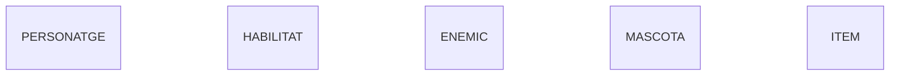

---

## Pas 2. Els atributs del personatge.

Ara que ja tenia les caixes principals, tocava dir com és cadascuna: quines dades en volem guardar. Això són els atributs, i es posen dins de les claus `{}`, indicant primer el tipus de dada (text, número, etc.) i després el nom.

Ho he fet entitat per entitat. Vaig començar pel personatge i ho vaig anar construint amb aquest codig:

```mermaidDesprés hi vaig afegir la resta de dades. El nom, el tipus i la qualitat són text (`string`). `Equipable` i `Comerciable` només poden ser sí o no, així que són de tipus `boolean`. I el pes és un número amb decimals, per això és de tipus `float`.

Les **mesures** em van fer pensar una mica més. Al PDF apareixen com una sola cosa, però en realitat són tres valors: X, Y i Z. Mermaid no té una manera de fer un atribut que es divideixi en parts, i la guia del professor diu que en aquests casos s'han de posar les parts com a atributs separats. Per això vaig crear `Mesura_X`, `Mesura_Y` i `Mesura_Z`, que també són números amb decimals (`float`).

I l'estructura quedaria així:

erDiagram
    PERSONATGE {
        string DNI PK
    }
```

Després hi vaig afegir la resta de dades. El nom i el cognom són text (`string`) i la vida, la força, l'agilitat i el carisma són números (`int`). 

I la estructura quedaria aixi:

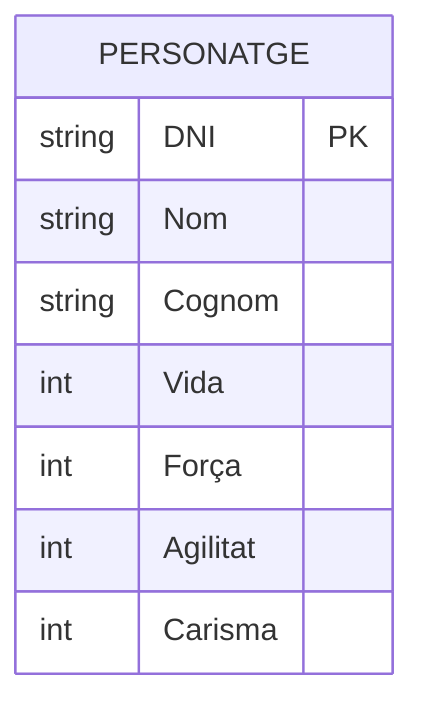

Per últim, vaig marcar què no pot quedar buit. Un personatge sense nom no té sentit, així que li vaig posar `"NOT NULL"`, que és com ho demana la guia del professor.

```mermaid
erDiagram
    PERSONATGE {
        string DNI PK
        string Nom "NOT NULL"
        string Cognom
        int Vida
        int Força
        int Agilita## Pas 6. Els atributs de l'ítem

Per acabar amb els atributs, tocava l'ítem, que és el que en té més. Al PDF té aquestes dades: nom, codi, equipable, comerciable, tipus, pes, qualitat i mesures (X, Y i Z).

Com sempre, vaig començar per la clau primària. L'ítem tampoc no té res tan únic com un DNI, així que vaig triar el **codi**, que és un número diferent per a cada ítem. És de tipus `int` i el marco amb `PK`:
t
        int Carisma
    }
```

---

## Pas 3. Els atributs de l'enemic

Després del personatge, vaig seguir amb l'enemic. Vaig tornar a mirar el PDF i l'enemic té aquestes dades: nom, codi, tipus, nivell, vida, agilitat, força i carisma.

Igual que amb el personatge, vaig començar buscant la dada que identifica cada enemic sense que es pugui repetir. Aquí no tenim un DNI, així que vaig triar el **codi**, que és un número diferent per a cada enemic. Com que és un número, el tipus és `int`, i el marco com a clau primària amb `PK`:

I la estructura quedaria aixi:

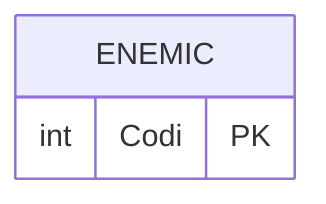

Després hi vaig afegir la resta de dades. El nom i el tipus d'enemic són text (`string`) i el nivell, la vida, l'agilitat, la força i el carisma són números (`int`).

I l'estructura quedaria així:

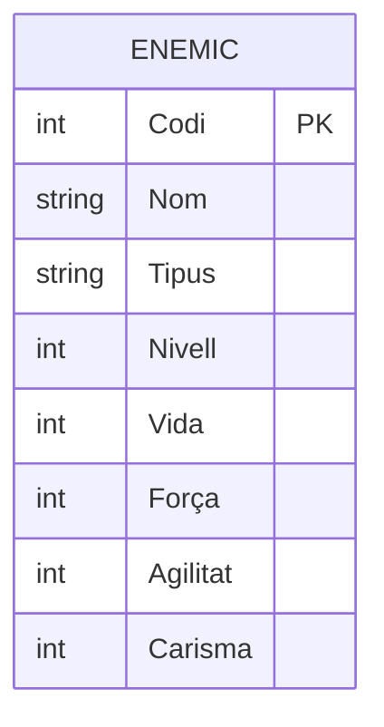

Per últim, vaig marcar què no pot quedar buit. Un enemic ha de tenir sempre nom, tipus i nivell, perquè sense aquestes dades no sabríem quin enemic és ni com de fort és. Per això els vaig posar `"NOT NULL"`:

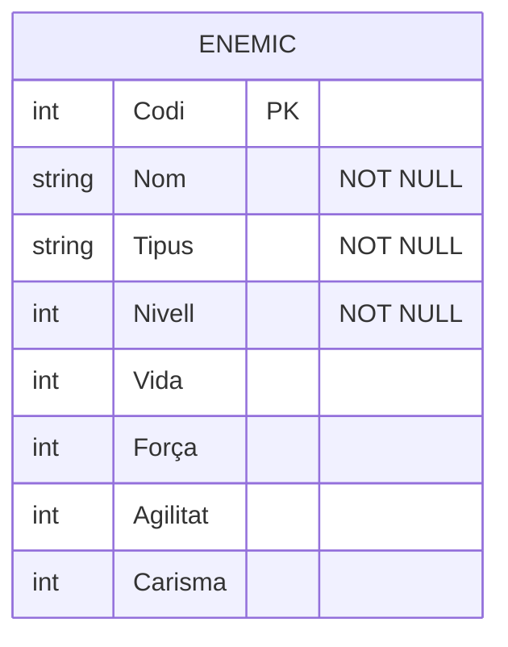

---

## Pas 4. Els atributs de Habilitats

Ara tocava l'habilitat. Al PDF té aquestes dades: nom, codi, cost, dany, cooldown i tipus.

Com amb l'enemic, vaig començar buscant la dada que identifica cada habilitat. Tampoc no hi ha res tan únic com un DNI, així que vaig triar el **codi**, que és un número diferent per a cada habilitat. És de tipus `int` i el marco com a clau primària amb `PK`:

I la estructura quedaria aixi:

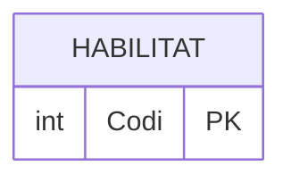

Després hi vaig afegir la resta de dades. El nom i el tipus d'habilitat són text (`string`) i el cost, el dany i el cooldown (el temps d'espera abans de poder tornar-la a fer servir) són números (`int`).

I l'estructura quedaria així:

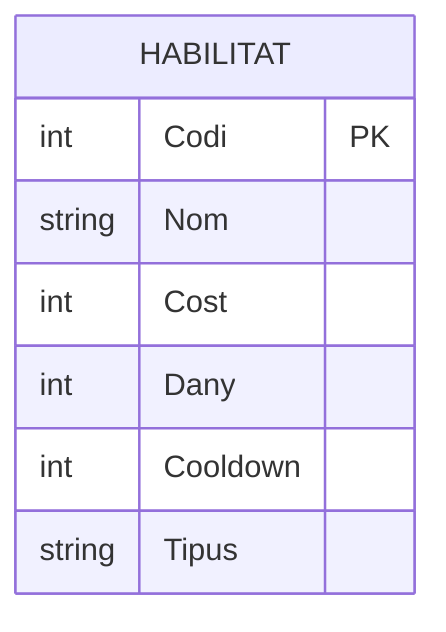

Per últim, vaig marcar què no pot quedar buit. Una habilitat ha de tenir sempre nom i tipus, perquè sense aquestes dues dades no sabríem com es diu ni quin tipus d'habilitat és. Per això els vaig posar `"NOT NULL"`:

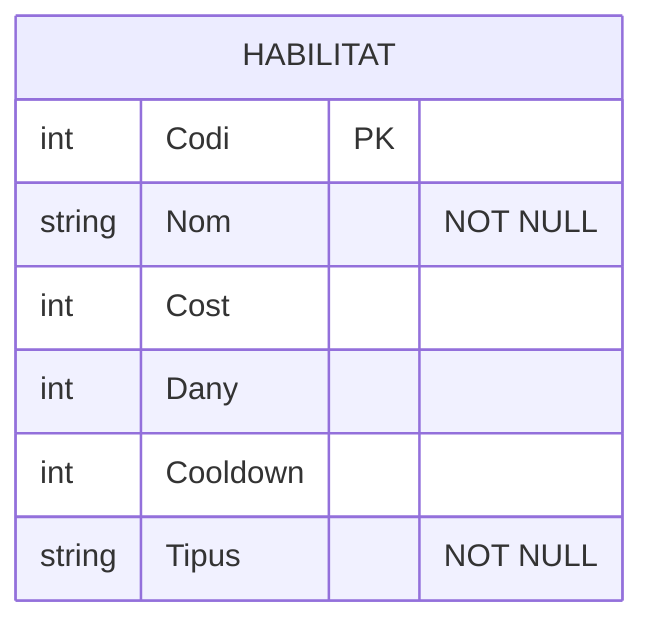

---

## Pas 5. Els atributs de la mascota

Ara tocava la mascota, que és la més curta. Al PDF només té tres dades: número de xip, nom i motxilla.

Per trobar la clau primària aquí ho vaig tenir fàcil. Igual que passa amb les mascotes de veritat, el **número de xip** és únic per a cada una, així que és la dada perfecta per identificar-les. Com que és més un codi que no pas un número amb què es vulgui fer operacions, el vaig posar de tipus text (`string`) i el vaig marcar amb `PK`:

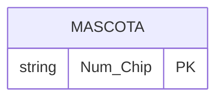

Després hi vaig afegir la resta de dades. El nom és text (`string`) i la motxilla és un número (`int`).

I l'estructura quedaria així:

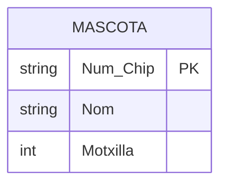

Per últim, vaig marcar què no pot quedar buit. Una mascota ha de tenir sempre nom, així que li vaig posar `"NOT NULL"`:

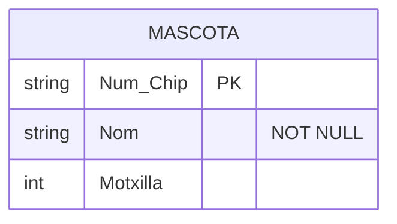

---

## Pas 6. Els atributs de l'ítem

Per acabar amb els atributs, tocava l'ítem, que és el que en té més. Al PDF té aquestes dades: nom, codi, equipable, comerciable, tipus, pes, qualitat i mesures (X, Y i Z).

Com sempre, vaig començar per la clau primària. L'ítem tampoc no té res tan únic com un DNI, així que vaig triar el **codi**, que és un número diferent per a cada ítem. És de tipus `int` i el marco amb `PK`:

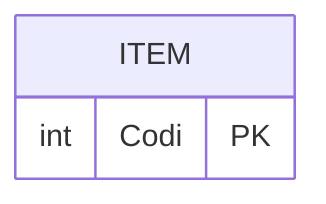

Després hi vaig afegir la resta de dades. El nom, el tipus i la qualitat són text (`string`). `Equipable` i `Comerciable` només poden ser sí o no, així que són de tipus `boolean`. I el pes és un número amb decimals, per això és de tipus `float`.

Les **mesures** em van fer pensar una mica més. Al PDF apareixen com una sola cosa, però en realitat són tres valors: X, Y i Z. Mermaid no té una manera de fer un atribut que es divideixi en parts, i la guia del professor diu que en aquests casos s'han de posar les parts com a atributs separats. Per això vaig crear `Mesura_X`, `Mesura_Y` i `Mesura_Z`, que també són números amb decimals (`float`).

I l'estructura quedaria així:

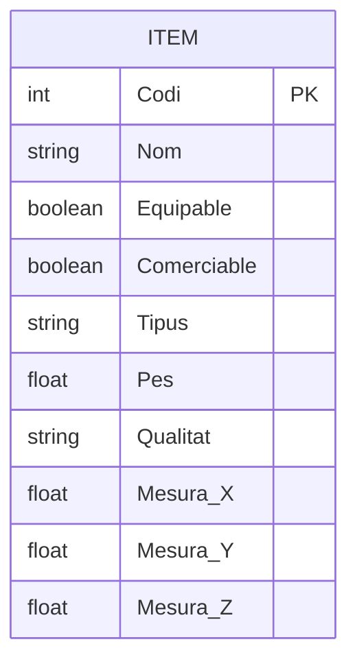

Per últim, vaig marcar què no pot quedar buit. Un ítem ha de tenir sempre nom, tipus, qualitat, pes i les tres mesures, perquè sense aquestes dades no el podríem descriure bé. També vaig marcar `Comerciable`, perquè el joc sempre ha de saber si un objecte es pot comprar i vendre o no. Per això a tots aquests els vaig posar `"NOT NULL"`. `Equipable` el vaig deixar sense marcar:

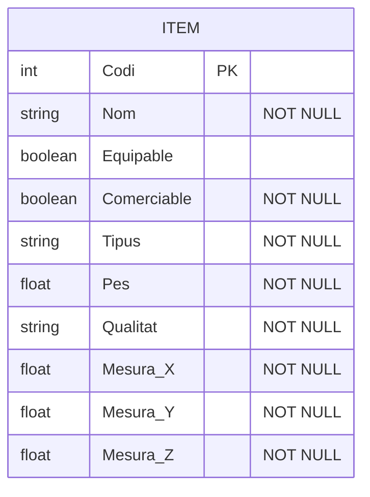

---

## Pas 7. Les entitats amb tots els atributs

Arribats aquí, ja tenia creats tots els atributs de les cinc entitats. Abans de seguir, vaig voler ajuntar-ho tot en un sol codi per veure com quedava el conjunt i comprovar que no em deixava res del PDF.

Aquest és el codi amb les cinc entitats completes, cadascuna amb la seva clau primària (`PK`), les seves dades i els atributs que no poden quedar buits (`"NOT NULL"`):

I les estructures quedarien aixi si esta tot be: 

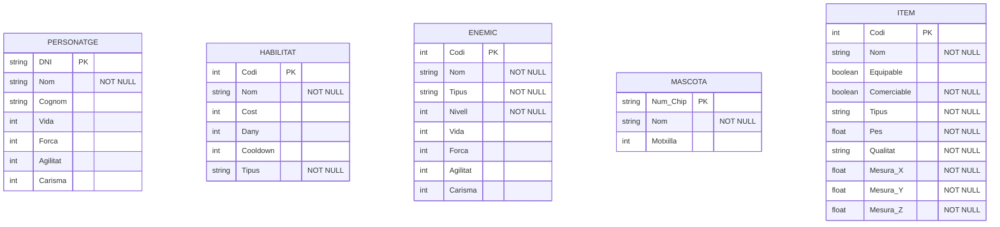
