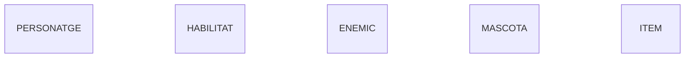
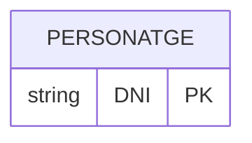
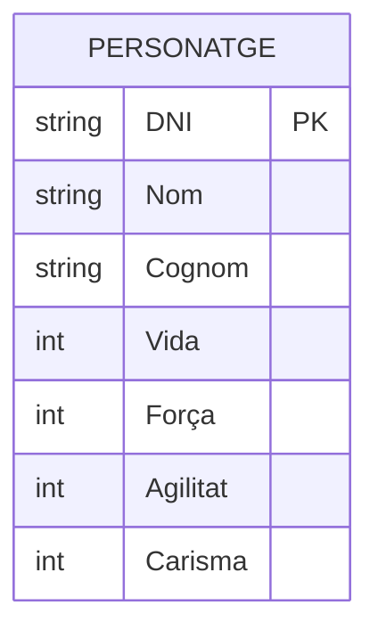
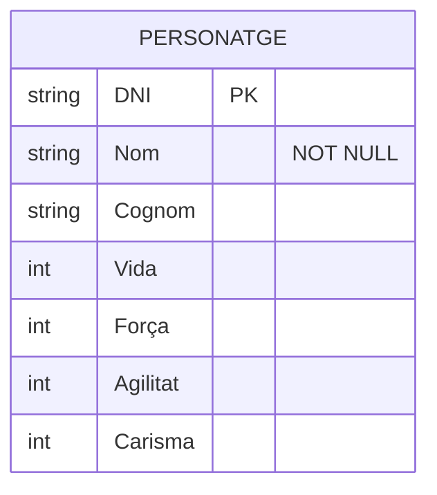
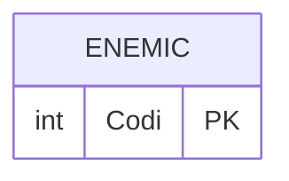
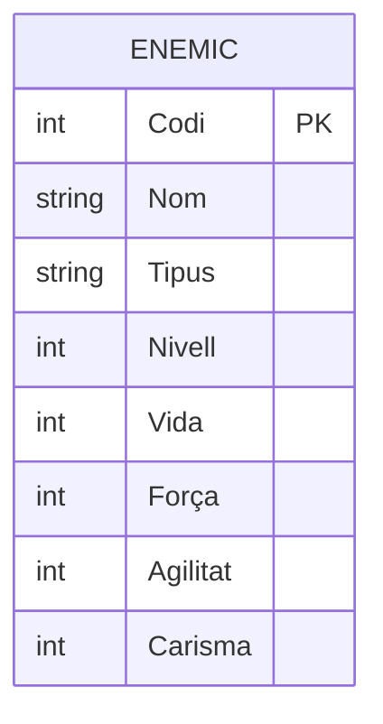
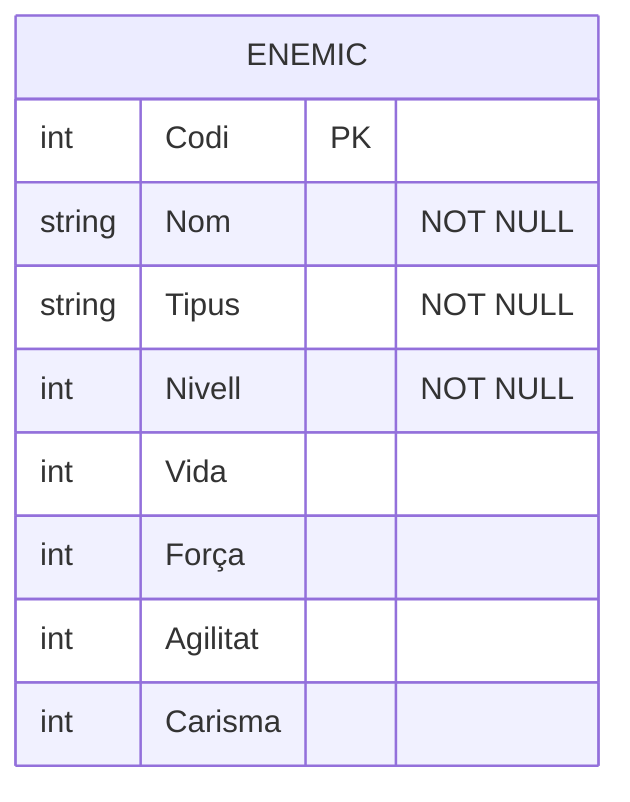

# Diagrama E/R del videojoc en Mermaid

En aquesta activitat explico com he fet el pas a pas del diagrama amb l'aplicació de Nermind. Al final del document hi ha el diagrama sencer.

## Pas 1. Les entitats
Primer de tot vaig mirar el document pdf de la tasca i vaig analitzar les entitats que son les següents:

- **PERSONATGE**: el protagonista, el que controla el jugador.
- **HABILITAT**: els poders o tècniques que poden fer servir els personatges i els enemics.
- **ENEMIC**: els rivals als quals s'enfronta el personatge.
- **MASCOTA**: l'animal que va amb el personatge.
- **ITEM**: els objectes del joc, com ara armes o armadures.

A Mermaid,he vist que per crear una entitat només cal escriure'n el nom en majúscules. Així que vaig començar posant les cinc, sense res més:

---

## Pas 2. Els atributs del personatge.

Ara que ja tenia les caixes principals, tocava dir com és cadascuna: quines dades en volem guardar. Això són els atributs, i es posen dins de les claus `{}`, indicant primer el tipus de dada (text, número, etc.) i després el nom.

Ho he fet entitat per entitat. Vaig començar pel personatge i ho vaig anar construint amb aquest codig:

Després hi vaig afegir la resta de dades. El nom i el cognom són text (`string`) i la vida, la força, l'agilitat i el carisma són números (`int`). 

I la estructura quedaria aixi:

Per últim, vaig marcar què no pot quedar buit. Un personatge sense nom no té sentit, així que li vaig posar `"NOT NULL"`, que és com ho demana la guia del professor.

---

## Pas 3. Els atributs de l'enemic

Després del personatge, vaig seguir amb l'enemic. Vaig tornar a mirar el PDF i l'enemic té aquestes dades: nom, codi, tipus, nivell, vida, agilitat, força i carisma.

Igual que amb el personatge, vaig començar buscant la dada que identifica cada enemic sense que es pugui repetir. Aquí no tenim un DNI, així que vaig triar el **codi**, que és un número diferent per a cada enemic. Com que és un número, el tipus és `int`, i el marco com a clau primària amb `PK`:

I la estructura quedaria aixi:

Després hi vaig afegir la resta de dades. El nom i el tipus d'enemic són text (`string`) i el nivell, la vida, l'agilitat, la força i el carisma són números (`int`).

I l'estructura quedaria així:

Per últim, vaig marcar què no pot quedar buit. Un enemic ha de tenir sempre nom, tipus i nivell, perquè sense aquestes dades no sabríem quin enemic és ni com de fort és. Per això els vaig posar `"NOT NULL"`:

---

## Pas 4. Els atributs de Habilitats

Ara tocava l'habilitat. Al PDF té aquestes dades: nom, codi, cost, dany, cooldown i tipus.

Com amb l'enemic, vaig començar buscant la dada que identifica cada habilitat. Tampoc no hi ha res tan únic com un DNI, així que vaig triar el **codi**, que és un número diferent per a cada habilitat. És de tipus `int` i el marco com a clau primària amb `PK`:

I la estructura quedaria aixi:

