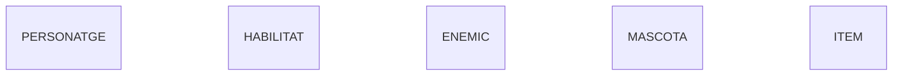
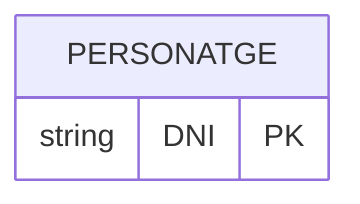

# Diagrama E/R del videojoc en Mermaid

En aquesta activitat explico com he fet el pas a pas del diagrama amb l'aplicació de Nermind. Al final del document hi ha el diagrama sencer.

## Pas 1. Les entitats
Primer de tot vaig mirar el document pdf de la tasca i vaig analitzar les entitats que son les següents:

- **PERSONATGE**: el protagonista, el que controla el jugador.
- **HABILITAT**: els poders o tècniques que poden fer servir els personatges i els enemics.
- **ENEMIC**: els rivals als quals s'enfronta el personatge.
- **MASCOTA**: l'animal que va amb el personatge.
- **ITEM**: els objectes del joc, com ara armes o armadures.

## Pas 2: El codig 
A Mermaid,he vist que per crear una entitat només cal escriure'n el nom en majúscules. Així que vaig començar posant les cinc, sense res més:

---

## Pas 3. Els atributs del personatge.

Ara que ja tenia les caixes principals, tocava dir com és cadascuna: quines dades en volem guardar. Això són els atributs, i es posen dins de les claus `{}`, indicant primer el tipus de dada (text, número, etc.) i després el nom.

Ho he fet entitat per entitat. Vaig començar pel personatge i ho vaig anar construint amb aquest codig:

